### Software Developer · Systems Engineer · Technology Enthusiast

> Building software that connects systems, automates processes, and solves real-world problems.

I'm a Software Developer with a background in Mechanical Engineering and a postgraduate degree in Data Science.

My work focuses on backend development, ERP customization, systems integration, and process automation.

I enjoy understanding complex systems, designing clean solutions, and exploring technologies that push the boundaries of software development.

---

### `~/about-me`

- Currently working with **Python, Odoo ERP and FastAPI**.
- Experienced in business process automation and systems integration.
- Interested in software architecture, backend engineering and Linux.
- Exploring new technologies and building personal projects.

### `~/tech-stack`

**Languages & Backend**

Python · JavaScript · SQL · FastAPI

**ERP & Integration**

Odoo · XML-RPC · REST APIs · PostgreSQL

**Frontend**

HTML · CSS · JavaScript

**Infrastructure & Tools**

Linux · Docker · Git · GitHub · Bash

### `~/featured-projects`

Projects and experiments focused on software engineering, automation, and infrastructure.

<!-- Add selected repositories here -->

### `~/currently-exploring`

- Software architecture and design patterns
- Go and systems programming
- Developer tooling and terminal customization
- Automation and distributed systems

### `~/contact`

- GitHub: [@gitgabrielrodri](https://github.com/gitgabrielrodri)

---

Building, learning, experimenting. One commit at a time.
